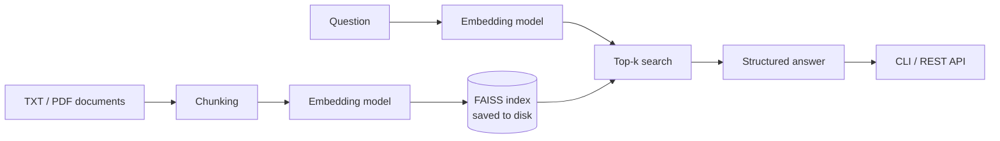

# AI Research Assistant (RAG)

[](https://github.com/hetanshigithub/ai-research-assistant-rag/actions/workflows/ci.yml)

This project is a simple research assistant that answers questions based on your own documents. Instead of relying on external APIs, everything runs locally using embeddings and semantic search.

I built this to better understand how retrieval-augmented generation (RAG) systems work under the hood.

It now includes a FAISS vector index that is saved to disk, a FastAPI service, a Docker setup, and an evaluation harness that measures retrieval and answer quality on a labeled question set.

## What it does

- Loads text and PDF files from a local folder
- Breaks them into smaller overlapping chunks
- Converts them into embeddings
- Stores the embeddings in a FAISS vector index, saved to disk and reused between runs
- Finds the most relevant pieces based on a question
- Generates a structured answer using the retrieved context

The output includes:

- A short summary
- Key insights
- Risks or limitations
- Supporting evidence from the documents
- A confidence score

## Why I built this

Most AI tools feel like black boxes. I wanted to build something from scratch that shows how systems like ChatGPT can use external knowledge instead of just relying on pre-trained data.

This project focuses on the core idea behind RAG:

**retrieve first, then generate**

## Architecture



How the pieces fit:

- **Vector store.** Embeddings are L2-normalized and stored in a FAISS inner-product index, so the score returned for each chunk is its cosine similarity to the question. The default `flat` index is exact. An approximate `hnsw` index is available for larger collections.
- **Persistence.** The index is saved together with the chunk text and metadata, because FAISS stores only vectors. A fingerprint of the documents, the chunking settings, the embedding model and the index type is saved with it. If any of these change, the index is rebuilt automatically; otherwise it is loaded from disk.
- **Pluggable embedder.** The default is `sentence-transformers/all-MiniLM-L6-v2`. An offline lexical embedder (`--model-name hashing`) needs no model download and is what the tests and CI use.

## Quick start

```bash
pip install -r requirements.txt
python main.py "impact of AI in finance"
```

Put your documents in `data/` (`.txt` and `.pdf`). Run `python main.py` without an argument to be prompted for a question.

| Option | Default | Meaning |
|---|---|---|
| `--top-k` | 4 | Chunks to retrieve |
| `--chunk-size` / `--chunk-overlap` | 180 / 35 | Chunking, in words |
| `--model-name` | `sentence-transformers/all-MiniLM-L6-v2` | Embedding model (`hashing` = offline) |
| `--index-dir` | `index` | Where the FAISS index is saved |
| `--index-type` | `flat` | `flat` (exact) or `hnsw` (approximate) |
| `--rebuild-index` | off | Ignore the saved index |

## REST API

```bash
uvicorn api.main:app --reload
```

Interactive docs are served at `http://localhost:8000/docs`. The embedding model and index are loaded once at startup, so each request only embeds the question, searches the index and formats the answer. The service refuses to start if the data folder is missing or empty.

| Method | Path | Description |
|---|---|---|
| `POST` | `/query` | Ask a question; returns the structured answer, the retrieved chunks with scores, and latency |
| `GET` | `/index` | Embedding model, dimension, index type, document and chunk counts |
| `GET` | `/health` | Reports whether the index is loaded (`503` on `/query` until it is) |

```bash
curl -s -X POST localhost:8000/query \
  -H 'Content-Type: application/json' \
  -d '{"question": "Why is an inner-product index used for cosine similarity?", "top_k": 3}'
```

Configuration through environment variables: `DATA_DIR` (`data`), `INDEX_DIR` (`index`), `EMBEDDING_MODEL` (`sentence-transformers/all-MiniLM-L6-v2`), `CHUNK_SIZE` (`180`), `CHUNK_OVERLAP` (`35`), `INDEX_TYPE` (`flat`).

## Docker

```bash
docker compose up --build
```

- The embedding model is downloaded when the image is built, so the container runs without network access.
- `./data` is mounted read-only; add or edit documents and restart to re-index.
- The FAISS index lives on a named volume, so restarts load it instead of re-embedding.
- The container runs as a non-root user and has a health check on `/health`.

## Evaluation

`evaluation/eval_set.jsonl` holds 37 questions: 30 that the documents answer and 7 that they do not. Each answerable question lists the exact text of its evidence and the facts a correct answer must contain.

```bash
python -m evaluation.run_eval                                   # default model
python -m evaluation.run_eval --embedding-model hashing         # offline, no download
python -m evaluation.run_eval --sweep-chunk-sizes 40,80,120,180 # chunk-size comparison
```

**Retrieval metrics**

| Metric | Definition |
|---|---|
| recall@k | Fraction of a question's evidence items found in the top-k chunks |
| hit@k | 1 if any top-k chunk contains evidence |
| precision@k | Fraction of the top-k chunks that contain evidence |
| MRR | Mean of 1/rank of the first chunk that contains evidence |

Evidence is labeled by its **text**, not by chunk number. A chunk is relevant if it contains the evidence phrase, so the labels stay valid when the chunk size changes. A test checks that every phrase still exists in its source document.

**Answer-quality checks** (no LLM judge, so they are simple proxies)

| Check | What it measures |
|---|---|
| Fact coverage | Share of the required facts that appear in the generated answer |
| Groundedness | Share of the answer's claims whose words are present in the retrieved text |
| Abstention | Whether the confidence score separates answerable from unanswerable questions (AUROC; 0.5 means no signal) |

### Results

These numbers use the **offline lexical embedder** (`hashing-2048`), the same one CI runs, with the default chunking (180 words, 20 chunks from 11 documents). They check the pipeline and the labels. They are **not** a measurement of a semantic embedding model; run the command above without `--embedding-model hashing` for that.

| k | recall@k | hit@k | precision@k |
|---|---------:|------:|------------:|
| 1 | 0.933 | 0.933 | 0.933 |
| 3 | 0.967 | 0.967 | 0.367 |
| 5 | 1.000 | 1.000 | 0.233 |

MRR 0.957 · fact coverage 0.767 · groundedness 1.000 · confidence AUROC 1.000

Chunk-size comparison, same embedder:

| Chunk size (words) | Chunks | recall@1 | recall@5 | MRR | Fact coverage |
|---:|---:|---:|---:|---:|---:|
| 40 | 70 | 0.667 | 0.917 | 0.814 | 0.825 |
| 80 | 35 | 0.817 | 0.950 | 0.907 | 0.800 |
| 120 | 23 | 0.800 | 0.967 | 0.900 | 0.733 |
| 180 | 20 | 0.933 | 1.000 | 0.957 | 0.767 |

What these runs show:

- **Smaller chunks trade recall for precision.** recall@1 falls from 0.933 to 0.667 as chunks shrink from 180 to 40 words, while fact coverage rises from 0.767 to 0.825.
- **The answer step limits quality more than retrieval.** Of the 8 answerable questions whose answers were missing a required fact, 7 had a relevant chunk ranked first. The extractive generator picked sentences from the right chunk that did not contain the fact.
- **Groundedness is 1.000 by construction.** The generator copies sentences from the context, so this check is a regression guard for when it is replaced by a generator that writes freely.
- **The default confidence threshold is not calibrated.** Confidence separates the two groups (AUROC 1.000), but a fixed threshold of 0.5 wrongly flags 57% of answerable questions. The evaluation prints a suggested threshold, which is fit on the same questions and therefore optimistic.

### Limitations of this evaluation

- The corpus is small (11 documents, 20 chunks at the default size), so recall@k is optimistic. With 20 chunks, a random top 5 already contains any given chunk 25% of the time.
- The questions were written from the documents, so they share vocabulary with them. Questions written independently would be harder.
- Fact coverage uses keyword matching and can miss correct paraphrases.
- Results from the offline embedder do not transfer to `all-MiniLM-L6-v2`.

## Tests

```bash
pip install -r requirements-dev.txt
python -m pytest
```

The suite uses the offline embedder, so it needs no model download. It covers the FAISS store (save and load, corrupt-index detection, dimension checks, HNSW), index invalidation for each setting that affects it, the API (including `503` before startup and startup failure with no documents), the metrics, the answer checks, and an end-to-end evaluation run. CI runs the tests and a retrieval regression gate on every push.

## Project layout

```
main.py                 CLI
api/                    FastAPI service (main.py, schemas.py)
src/
  data_loader.py        TXT/PDF loading
  chunking.py           overlapping word chunks
  embeddings.py         sentence-transformers wrapper + offline embedder
  vector_store.py       FAISS index, persistence
  retriever.py          embeds queries, searches the store
  pipeline.py           build-or-load logic with staleness detection
  generator.py          structured answer from retrieved chunks
evaluation/             eval set, metrics, answer checks, runner
tests/
Dockerfile, docker-compose.yml, .github/workflows/ci.yml
```

## Notes

- This runs fully locally (no paid API required)
- Works best with small to medium document sets
- Designed as a learning project, not production-ready

## Future improvements

- Improve the answer step: sentence selection is where most missed facts come from
- Add a reranker on top of the FAISS results
- Evaluate with `all-MiniLM-L6-v2` and larger models on a bigger, independently written question set
- Add simple UI (Streamlit or web app)

## Final thoughts

This was a hands-on way for me to understand how modern AI systems combine search and generation. It’s a simplified version, but the core ideas are the same as what’s used in real-world applications.
