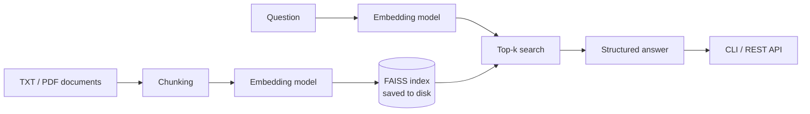

# AI Research Assistant (RAG)

[](https://github.com/hetanshigithub/ai-research-assistant-rag/actions/workflows/ci.yml)

This project is a simple research assistant that answers questions based on your own documents. Instead of relying on external APIs, everything runs locally using embeddings and semantic search.

I built this to better understand how retrieval-augmented generation (RAG) systems work under the hood.

It now includes a FAISS vector index that is saved to disk, a FastAPI service, a Docker setup, and an evaluation harness that measures retrieval and answer quality on a labeled question set.

## What it does

- Loads text and PDF files from a local folder
- Breaks them into smaller overlapping chunks
- Converts them into embeddings
- Stores the embeddings in a FAISS vector index, saved to disk and reused between runs
- Finds the most relevant pieces based on a question
- Generates a structured answer using the retrieved context

The output includes:

- A short summary
- Key insights
- Risks or limitations
- Supporting evidence from the documents
- A confidence score

## Why I built this

Most AI tools feel like black boxes. I wanted to build something from scratch that shows how systems like ChatGPT can use external knowledge instead of just relying on pre-trained data.

This project focuses on the core idea behind RAG:

**retrieve first, then generate**

## Architecture



A few notes on how it works:

- Embeddings are normalized and stored in a FAISS inner-product index, so the score for each chunk is its cosine similarity to the question. The default `flat` index is exact. `hnsw` is available if the document set gets large.
- FAISS only stores vectors, so the chunk text and metadata are saved next to the index. A fingerprint of the documents, chunk settings, model and index type is saved too. If any of those change, the index is rebuilt. Otherwise it is loaded from disk.
- The default model is `sentence-transformers/all-MiniLM-L6-v2`. There is also a small offline embedder (`--model-name hashing`) that needs no download. The tests and CI use it.

## Quick start

```bash
pip install -r requirements.txt   # tested on Python 3.12; PyTorch may lack wheels for the newest Python
python main.py "impact of AI in finance"
```

Put your documents in `data/` (`.txt` and `.pdf`). Run `python main.py` without an argument to be prompted for a question.

| Option | Default | Meaning |
|---|---|---|
| `--top-k` | 4 | Chunks to retrieve |
| `--chunk-size` / `--chunk-overlap` | 180 / 35 | Chunking, in words |
| `--model-name` | `sentence-transformers/all-MiniLM-L6-v2` | Embedding model (`hashing` = offline) |
| `--index-dir` | `index` | Where the FAISS index is saved |
| `--index-type` | `flat` | `flat` (exact) or `hnsw` (approximate) |
| `--rebuild-index` | off | Ignore the saved index |

## REST API

```bash
uvicorn api.main:app --reload
```

Interactive docs are at `http://localhost:8000/docs`. The model and index are loaded once at startup. If the data folder is missing or empty, the service refuses to start.

| Method | Path | Description |
|---|---|---|
| `POST` | `/query` | Ask a question; returns the structured answer, the retrieved chunks with scores, and latency |
| `GET` | `/index` | Embedding model, dimension, index type, document and chunk counts |
| `GET` | `/health` | Reports whether the index is loaded (`503` on `/query` until it is) |

```bash
curl -s -X POST localhost:8000/query \
  -H 'Content-Type: application/json' \
  -d '{"question": "Why is an inner-product index used for cosine similarity?", "top_k": 3}'
```

Settings come from environment variables: `DATA_DIR`, `INDEX_DIR`, `EMBEDDING_MODEL`, `CHUNK_SIZE`, `CHUNK_OVERLAP` and `INDEX_TYPE` (defaults are in `api/main.py`).

## Docker

```bash
docker compose up --build
```

The model is downloaded while the image is built, so the container does not need internet at runtime. `./data` is mounted read-only, and the FAISS index is kept on a named volume so restarts don't re-embed everything. The container runs as a non-root user and has a health check on `/health`.

## Evaluation

`evaluation/eval_set.jsonl` has 37 questions: 30 that the documents answer and 7 that they don't. Each answerable question lists the exact text of its evidence and the facts a correct answer should contain.

```bash
python -m evaluation.run_eval                                   # default model
python -m evaluation.run_eval --embedding-model hashing         # offline, no download
python -m evaluation.run_eval --sweep-chunk-sizes 40,80,120,180 # chunk-size comparison
```

Retrieval metrics:

| Metric | Definition |
|---|---|
| recall@k | Fraction of a question's evidence items found in the top-k chunks |
| hit@k | 1 if any top-k chunk contains evidence |
| precision@k | Fraction of the top-k chunks that contain evidence |
| MRR | Mean of 1/rank of the first chunk that contains evidence |

Evidence is labeled by its text, not by chunk number. A chunk counts as relevant if it contains the evidence phrase, so the labels still work when the chunk size changes. A test checks that every phrase exists in its source document.

Answer-quality checks (no LLM judge, so these are simple proxies):

| Check | What it measures |
|---|---|
| Fact coverage | Share of the required facts that appear in the generated answer |
| Groundedness | Share of the answer's claims whose words are present in the retrieved text |
| Abstention | Whether the confidence score separates answerable from unanswerable questions (AUROC; 0.5 means no signal) |

### Results

Measured with `sentence-transformers/all-MiniLM-L6-v2`, default chunking (180 words, overlap 35, 20 chunks from 11 documents), 30 answerable and 7 unanswerable questions.

| k | recall@k | hit@k | precision@k |
|---|---------:|------:|------------:|
| 1 | 0.683 | 0.700 | 0.700 |
| 3 | 0.867 | 0.867 | 0.344 |
| 5 | 0.933 | 0.933 | 0.220 |

MRR 0.798 · fact coverage 0.717 (all required facts present for 66.7% of questions) · groundedness 1.000 · confidence AUROC 1.000

Chunk-size comparison, same model (overlap is 20% of the chunk size in this sweep):

| Chunk size (words) | Chunks | recall@1 | recall@3 | recall@5 | MRR | Fact coverage |
|---:|---:|---:|---:|---:|---:|---:|
| 40 | 70 | 0.650 | 0.800 | 0.833 | 0.768 | 0.669 |
| 80 | 35 | 0.667 | 0.883 | 0.917 | 0.803 | 0.811 |
| 120 | 23 | 0.533 | 0.900 | 0.933 | 0.725 | 0.733 |
| 180 | 20 | 0.750 | 0.900 | 0.933 | 0.829 | 0.717 |

The offline lexical embedder used by CI (`--embedding-model hashing`) scores recall@1 0.933 and recall@5 1.000 on the same questions. It is kept as a fast regression baseline, not as a quality claim (see the limitations below).

What I take from this:

- The right evidence is in the top 5 for 93% of questions and ranked first for 70%. Four questions have no relevant chunk in the top 3 (q06, q13, q18, q27).
- Chunk size doesn't show a clean trend. recall@1 and MRR are best at 180 words, fact coverage is best at 80 words, and 120 words is worst for recall@1. With 30 questions, one question moves recall@1 by 0.033, so small differences are noise. The 180 row (0.750) differs from the main run (0.683) only because the sweep uses an overlap of 36 words instead of 35.
- Fact coverage (0.717) is well below recall@5 (0.933), so some retrieved evidence doesn't make it into the extractive answer.
- Groundedness is 1.000 because the generator copies sentences from the context. The check is there to catch regressions if the generator is ever replaced.
- Confidence separates the two groups well (mean 0.651 for answerable, 0.226 for unanswerable). The default threshold of 0.5 flags all 7 unanswerable questions but also 2 of the 30 answerable ones. The suggested threshold of 0.382 is fit on the same questions, so it is optimistic.

### Limitations of this evaluation

- The corpus is small (11 documents, 20 chunks at the default size), so recall@k is optimistic. With 20 chunks, a random top 5 already contains any given chunk 25% of the time.
- The questions were written from the documents, so they share vocabulary with them. Questions written independently would be harder.
- Fact coverage uses keyword matching and can miss correct paraphrases.
- The offline lexical embedder scores higher than MiniLM here (recall@1 0.933 vs 0.683) because the questions reuse wording from the documents. That reflects the question set, not a better embedder.
- Seven unanswerable questions are too few to trust the abstention numbers beyond "the signal exists".

## Tests

```bash
pip install -r requirements-dev.txt
python -m pytest
```

The tests use the offline embedder, so no model download is needed. They cover the FAISS store (save and load, corrupt index, dimension checks, HNSW), when the index gets rebuilt, the API (including `503` before startup and failing to start with no documents), the metrics, the answer checks, and a full evaluation run. CI runs the tests and a recall@5 check on every push.

## Project layout

```
main.py                 CLI
api/                    FastAPI service (main.py, schemas.py)
src/
  data_loader.py        TXT/PDF loading
  chunking.py           overlapping word chunks
  embeddings.py         sentence-transformers wrapper + offline embedder
  vector_store.py       FAISS index, persistence
  retriever.py          embeds queries, searches the store
  pipeline.py           build-or-load logic with staleness detection
  generator.py          structured answer from retrieved chunks
evaluation/             eval set, metrics, answer checks, runner
tests/
Dockerfile, docker-compose.yml, .github/workflows/ci.yml
```

## Notes

- This runs fully locally (no paid API required)
- Works best with small to medium document sets
- Designed as a learning project, not production-ready

## Future improvements

- Improve the answer step: sentence selection is where most missed facts come from
- Add a reranker on top of the FAISS results
- Evaluate with `all-MiniLM-L6-v2` and larger models on a bigger, independently written question set
- Add simple UI (Streamlit or web app)

## Final thoughts

This was a hands-on way for me to understand how modern AI systems combine search and generation. It’s a simplified version, but the core ideas are the same as what’s used in real-world applications.
